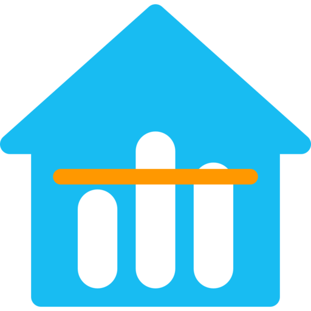

<p align="center">
  
</p>

# Area Averages

A Home Assistant integration that gives each area one sensor averaging the
sensors in it, and tells you which of those sensors are offline, stale or low
on battery.

If a room has six temperature sensors and two of them die, you still get a
temperature from the other four, along with `4 of 6 sensors` and the names of
the two that stopped reporting.

<!-- Screenshot: the integration page in Settings → Devices & Services, showing
     one row per average (subentries) with their gear icons. -->

## Features

- One average per area and sensor type: temperature, humidity, pressure, CO2,
  illuminance or PM2.5.
- Works out membership from the area. Move a sensor into a room and it joins
  that room's average within a couple of seconds.
- Leaves out offline and stale sensors, and lists them (plus low batteries) in
  the sensor's attributes.
- Converts mixed units (°C and °F, for example) before averaging.
- Optional auto-discovery creates an average for every area that has matching
  sensors.
- Also reports minimum, maximum, spread and a rising/falling trend.
- No dependencies outside Home Assistant core.
- An optional dashboard strategy builds a full "Area Temperatures" dashboard
  from these sensors.

## Installation

Requires Home Assistant 2026.3 or newer.

### HACS

1. In HACS, open the menu → **Custom repositories**.
2. Add `https://github.com/chadlipscomb/ha-area-averages` as an
   **Integration**.
3. Install **Area Averages** and restart Home Assistant.

### Manual

Copy `custom_components/area_averages` into your Home Assistant
`config/custom_components/` folder and restart.

## Setup

Go to **Settings → Devices & Services → Add integration** and pick
**Area Averages**. Setup asks whether to discover averages automatically and,
if so, for which sensor types.

<!-- Screenshot: the setup dialog (auto-discovery toggle + sensor types). -->

To add an average by hand, open the integration and choose **Add an average**.
Pick an area and what it measures. The next step decides which sensors go in:

| Mode | Members |
|---|---|
| Everything in the area (default) | Every sensor of that type in the area, except ones carrying the exclude label |
| Only these sensors | The sensors you pick, plus anything in the area carrying the include label you choose |

<!-- Screenshot: the "Which sensors go in?" step of the subentry flow. -->

To keep a sensor out of an average, add the `exclude-average` label to the
sensor or to its device. Diagnostic and disabled entities are always left out.

The new sensor is named `sensor.<area>_average_<type>` and is assigned to its
area, so it shows up on area cards and to voice assistants.

## How a sensor is counted

Every member is in exactly one of three states:

| State | Meaning | Counted in the average? |
|---|---|---|
| reporting | Has a usable number | yes |
| stale | Has a number, but its last report is older than the stale limit (24 h by default) | no |
| offline | Unavailable, unknown, not a number, or in a unit that can't be converted | no |

The average's state is the mean of the reporting members, in your system's
unit. It is `unknown` only when nothing reports. Last-report times survive a
restart, so a restart doesn't reset the stale clock.

## Attributes

| Attribute | Meaning |
|---|---|
| `summary` | Short coverage text: `9 sensors`, `2 of 9 sensors`, `no sensors reporting` |
| `healthy` | `true` when something reports and there are no issues |
| `issue` / `issues` | Offline, stale and low-battery problems as text, e.g. `Kitchen Thermometer: offline` |
| `reporting` / `member_count` | Members in the mean / all members |
| `offline` / `stale` / `low_battery` | Entity IDs in each group |
| `minimum` / `maximum` / `spread` | Range of the values in the mean |
| `trend` / `trend_rate` | `rising`, `falling`, `steady` or `unknown`, and the rate per hour. Kept in memory, so it reads `unknown` for about 15 minutes after a restart |
| `sensors` / `excluded` | Members, and sensors left out by label or include mode |

<!-- Screenshot: the average's more-info dialog with its attributes expanded. -->

## Options

These apply to every average. Open the integration and choose **Configure**.

| Option | Default |
|---|---|
| Discover averages automatically | off |
| Sensor types to discover | temperature |
| Stale after | 24 hours |
| Low battery threshold | 20 % |
| Trend window | 120 minutes |
| Exclude label | `exclude-average` |
| Averages auto-discovery must not re-create | none |

If you delete an average that auto-discovery made, it won't come back. Untick
it in the last option to allow it again. Turning discovery off keeps the
averages it already created.

## Dashboard (optional)

`www/area_averages_strategy.js` is a dashboard strategy that builds the whole
dashboard every time it loads: one section per area with the temperature in
large type, buttons that reveal the room's sensors or only its offline ones,
and a Trends view with statistics graphs.

<!-- Screenshot: the Rooms view, a few areas with temperatures and buttons. -->
<!-- Screenshot: one room with its sensors revealed, including an offline one. -->
<!-- Screenshot: the Trends view. -->

1. Copy `www/area_averages_strategy.js` to `config/www/`.
2. Add it as a resource: **Settings → Dashboards → ⋮ → Resources**, URL
   `/local/area_averages_strategy.js`, type **JavaScript module**.
3. Create a new dashboard, open its raw configuration editor and replace
   everything with:

   ```yaml
   strategy:
     type: custom:area-temperatures
   ```

Don't use **Take control** on this dashboard. It freezes the generated cards
into a static copy.

The dashboard works with core cards alone. If
[Mushroom](https://github.com/piitaya/lovelace-mushroom) and
[card-mod](https://github.com/thomasloven/lovelace-card-mod) are installed it
uses them for a frosted-glass look. Strategy options go under `strategy:`:

| Option | Default | Effect |
|---|---|---|
| `glass` | `true` | `false` gives plain HA cards |
| `detail` | `compact` | `full` adds the range and trend under each temperature |
| `cards` | `auto` | `native` forces core cards, `mushroom` skips the check |
| `stats_days` | `7` | Length of the Trends graphs |
| `areas` | `{}` | Per area: `group` (`inside`, `outdoors`, `equipment`) and `band` (`default`, `fridge`, `none`) |

The temperature colours use comfort bands in °F (65 / 68 / 78 / 84).

## Without the integration

Two other versions of the same idea live in this repo, for setups that can't
run custom components:

- [`yaml-edition/`](yaml-edition/) uses template sensors and a Jinja macro. It
  has most of the health reporting but needs a generator re-run for new areas.
- [`native-edition/`](native-edition/) uses only built-in Group helpers and
  core cards. It gives you the average but no health reporting.

## Development

```sh
uv venv .venv
uv pip install pytest-homeassistant-custom-component
.venv/bin/python -m pytest
```

`tests/` covers the calculation without Home Assistant. `tests/integration/`
starts a real Home Assistant and covers setup, subentries, auto-discovery and
migration from 0.3.x. `node tools/test_strategy.mjs` checks the dashboard
strategy against `tools/fixture.json`.

The scripts in `tools/` and the two editions talk to a live instance. Point
them at yours with `HA_URL` and `HA_TOKEN` (a long-lived access token).

## License

[MIT](LICENSE)
